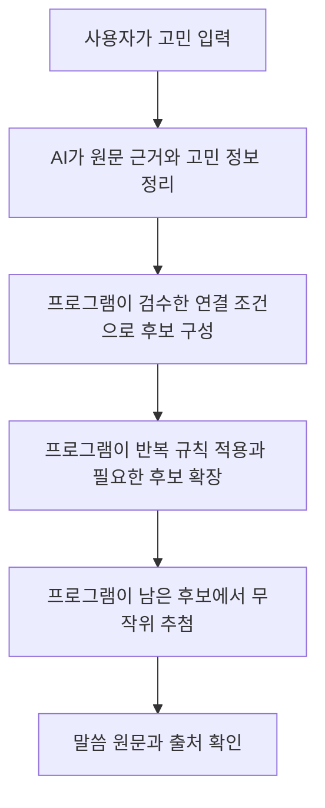

# 고민 해석을 말씀 후보에 연결하는 설계 제안

> 2026-10-07 공동 검토용 초안. ②의 개입 범위·추가 질문 없는 입력·가볍고 빠른 뽑기 경험은 확정됐다. 아래 필드·분류·규칙·평가 방법·세부 화면은 제안이며 실제 말씀 데이터나 모델을 실행한 결과가 아니다.

## 목표와 확정된 경계

사용자가 자신의 상황에 딱 맞고 운명적으로 느껴지는 말씀을 만나, 선택의 실마리를 얻고 후련해지는 것이 목표다. 초기 AI는 고민을 해석한다. 후보 자격·추첨은 검수한 데이터와 규칙이 결정한다. 후속으로 첫 버전은 반복 규칙을 적용한 뒤 남은 충분한 후보를 모두 같은 확률로 뽑기로 정했다. 말씀 후보를 AI에 전달해 평가시키는 것은 ③ 확장에 해당한다.

**사용자는 한 번 입력한 고민만으로 추가 질문 없이 뽑는다. AI에게 말씀을 추천받는 느낌이 들어서는 안 되며, 가볍고 빠르게 뜻밖의 실마리를 받는 경험을 지향한다.** AI 해석의 형식은 내부 선정·검토용 데이터다.

제안하는 핵심은 **고민의 선택 구조를 원문 근거와 함께 정리하고, 검수한 `구체 고민 × 말씀` 조합의 적용 조건에 연결하는 것**이다. 구매라는 주제만으로 후보를 열거나, 죄책감이라는 감정만으로 절제 구절을 확정하는 방식은 피한다.

## 1. AI가 정리할 정보의 제안

| 정보 | 정리할 내용 | 사용하는 이유 |
|---|---|---|
| 선택지 | 사용자가 망설이는 행동들. 개수를 두 개로 강제하지 않음 | 어떤 선택 사이의 고민인지 구별 |
| 각 선택의 이유·부담 | 사용자가 말한 바라는 점과 걸리는 점 | 같은 행동이라도 다른 갈등을 구별 |
| 핵심 갈등 | 양쪽 부담이 어떤 관계인지, 그 근거 | 검수된 사례를 찾는 조건으로 사용 |
| 명시된 조건 | 최근 구매, 실제 자금 부족, 시간 제한처럼 입력에 드러난 조건 | 표면적으로 비슷한 고민의 중요한 차이를 반영 |
| 확인되지 않은 조건 | 지출 여력, 희소성 등 입력에서 알 수 없는 조건 | 없다고 가정하거나 임의로 채우지 않음 |
| 원문 근거·해석 상태 | 원문에 명시됨 / 해석상 추정 / 알 수 없음 | 의미가 덧붙은 지점을 추적하고 오류를 검토 |

주제는 넓은 색인으로 활용할 수 있다. `필요한 말씀은 절제`, `사용자는 구매 허락을 원함`, `권장 행동은 구매` 같은 선정·행동 결론은 초기 AI의 출력 항목에 넣지 않는다.

추정 항목은 사실과 구별한다. 핵심 후보 자격에 어떤 추정을 허용할지는 별도 공동 결정이며, 필수 조건을 추정으로 통과시키는 설계를 기본으로 삼지 않는다. AI가 내는 자신감 숫자를 실제 해석 정확도나 사용자 만족 확률로 간주하지 않는다.

### 구매 고민의 예시

입력 예시:

> 며칠 전에도 옷을 샀는데 비싼 자켓이 사고 싶어. 사면 죄책감이 들고 안 사면 아쉬워.

| 정리할 내용 | 예시 |
|---|---|
| 선택 | 지금 구매 / 지금 구매하지 않음 |
| 구매할 이유 | 사고 싶은 자켓이 있음 |
| 구매 쪽 부담 | 죄책감 |
| 구매하지 않는 쪽 부담 | 아쉬움 |
| 확인된 조건 | 최근에도 옷을 샀음, 가격이 비싸다고 느끼고 있음 |
| 알 수 없는 조건 | 실제 지출 여력, 생활비 영향, 한정 판매 여부 |

`비싸다`는 표현만으로 자금 부족을 확정하지 않는다. `죄책감`만으로 과소비나 의지 부족을 확정하지 않는다. 구매 또는 보류 어느 쪽을 원한다고도 확정하지 않는다.

### 기계가 사용할 출력 형태의 예시

아래는 출력 형식 후보이며 모델의 실제 응답이나 확정된 스키마가 아니다. 코드 이름과 전체 필드는 함께 정한다.

```json
{
  "analysis_version": "proposal-1",
  "choices": [
    { "id": "buy_now", "label": "지금 구매", "stated_reason": "사고 싶은 자켓", "burden": "죄책감" },
    { "id": "not_buy_now", "label": "지금 구매하지 않음", "stated_reason": null, "burden": "아쉬움" }
  ],
  "tensions": [
    { "code": "desire_vs_purchase_guilt", "status": "explicit", "evidence_ids": ["e2", "e3"] },
    { "code": "regret_if_not_buying", "status": "explicit", "evidence_ids": ["e4"] }
  ],
  "conditions": {
    "recent_purchase": { "value": true, "status": "explicit", "evidence_id": "e1" },
    "financial_capacity": { "value": null, "status": "unknown", "evidence_id": null },
    "limited_availability": { "value": null, "status": "unknown", "evidence_id": null }
  },
  "evidence": [
    { "id": "e1", "quote": "며칠 전에도 옷을 샀는데" },
    { "id": "e2", "quote": "비싼 자켓이 사고 싶어" },
    { "id": "e3", "quote": "사면 죄책감이 들고" },
    { "id": "e4", "quote": "안 사면 아쉬워" }
  ]
}
```

정해진 구조의 출력과 서버 검증을 사용한다. 인용한 근거가 실제 입력에 있는지 확인하고, 해석의 적절성은 사례 검토와 실제 피드백으로 살핀다. 형식이 유효하고 인용이 존재해도 그 인용을 올바르게 해석했다는 보장은 없다.

## 2. 말씀에 붙일 데이터의 제안

구절마다 카테고리 태그를 붙이는 데서 멈추지 않고, 아래와 같은 **사례와 말씀의 연결 기록**을 만든다.

| 연결 기록 | 내용 |
|---|---|
| 사례 ID·고민 원문 | 구체적으로 어떤 고민에 대조했는지 |
| 선택의 구조·명시 조건 | AI 출력과 코드 규칙으로 연결할 요소 |
| 구절 ID·역본·본문 버전 | 실제로 사용자에게 보여줄 검수된 본문 |
| 자연스러운 연결의 근거 | 설명을 붙이지 않아도 사용자가 읽을 실마리가 있는지 |
| 필수 적용 조건 | 이 조건이 확인돼야 연결을 사용할 수 있는지 |
| 배제 조건·반례 | 같은 주제여도 어떤 상황에서는 안 맞는지 |
| 평가 출처 | 생성 사례, 공동 사전 검토, 실제 사용자 반응의 구별 |
| 문맥 검수 | 본문과 앞뒤 문맥을 왜곡하지 않는 연결인지 |

예컨대 실제 지출 여력이 충분한 상황에서 검수한 연결을, 지출 여력이 확인되지 않은 모든 구매 고민에 자동 적용하지 않는다. 모든 기쁨 관련 구절에 같은 재정 조건을 붙이는 것도 아니다. **필수 조건은 개별 `사례 × 구절` 연결마다 정한다.**

구매·보류로 읽힐 수 있는 여러 후보를 개별적으로 검수한다. 특정 방향을 확인해 주는 것을 성공으로 삼거나 양쪽 확률을 기계적으로 반반 맞추는 규칙은 채택하지 않았다.

## 3. 해석에서 후보를 만드는 규칙의 제안

1. **적용 자격 확인:** 핵심 갈등과 조건이 검수한 연결에 맞는지 확인한다. 명시된 반례나 상충 조건이 있으면 해당 연결을 제외한다.
2. **모르는 조건 구별:** 필수 조건이 미확인이면 그 연결을 통과시키지 않고 보류한다. 조건이 알려지지 않았다는 이유로 모든 구절을 제외하지는 않는다. 확인된 정보만으로 성립하는 다른 연결도 찾는다.
3. **핵심 갈등과 세부 조건의 일치 정도 비교:** 단순한 주제 일치보다 갈등과 적용 조건이 구체적으로 맞는 연결을 우선한다. 비교 항목·가중치·통과 기준은 공동 결정한다. 상충하는 필수 조건은 높은 다른 점수로 상쇄하지 않는다.
4. **간접 연결 포함:** 다른 카테고리의 말씀도 이 구체 고민에서 자연스럽고 방향 있는 실마리가 된다는 검수 근거가 있으면 포함한다. 낯선 구절을 일정 비율로 무조건 섞지는 않는다.
5. **구절 단위로 후보 정리:** 여러 사례에서 같은 구절을 찾았으면 하나의 후보로 묶고 연결 근거를 보존한다. 사례를 많이 달았다는 이유만으로 추첨 확률이 부풀지 않도록 한다.
6. **통과한 후보에서 추첨:** 후속 공동 결정에 따라 첫 버전은 반복 규칙 적용 후 남은 충분한 말씀 후보를 같은 확률로 뽑는다. 후보 자격의 조건과 통과 기준은 계속 공동 검토한다. 후보가 부족하면 검수된 연결 범위를 넓혀 다른 말씀을 제공하며, 다양성만을 이유로 불충분한 후보를 자동 추가하지 않는다.

이 규칙에서 AI는 현재 고민을 읽을 뿐, 말씀별 점수나 채택·탈락 여부를 판단하지 않는다. 충분히 구체적인 사례와 적용 조건이 없으면 이 설계도 좋은 결과를 만들기 어렵다.

## 4. 정보가 부족할 때의 경계

사용자는 **추가 질문 없이 원래 입력만으로 뽑기**를 선택했다. 핵심 조건이 모호해도 선정 전 확인 질문을 추가하지 않는다.

제안하는 규칙은 확인되지 않은 필수 조건에 기대는 연결을 보류하고, 원문에서 확인한 갈등만으로 성립하는 다른 연결을 찾는 것이다. 원문에 없는 조건을 채워 넣어 후보 자격을 만들지 않는다. 부족한 사례 범위를 기록해 다음 자료 분석에서 검수 데이터를 보완한다.

추가 정보가 없어도 작동하는 연결은 별도로 검수한다. 후속으로 사용자는 항상 말씀을 뽑을 수 있어야 하며, 다시 뽑기에서는 직전 말씀을 제외한 채 범위를 확장해 다른 말씀을 제공하라고 정했다. 특정 한 구절을 정해 주는 역할보다 검수된 후보 묶음 안에서 사용자의 무작위 뽑기를 돕는 역할을 강조했다. [반복 회피와 후보 확장](verse-classification-proposal.md#12-새로운-고민의-첫-뽑기에서-반복을-줄이는-결정)에 이 결정을 반영한다.

주제가 달라도 갈등이 닮은 검수 조합, 더 넓게 대조한 기본 후보 묶음으로 확장하는 단계는 제안이다. 세부 확장 조건·기본 후보 검수·기술 오류 복구는 공동 결정한다. 범위를 넓혀도 원문에 없는 조건을 만들어 적합함을 주장하지 않는다. 좋은 효과를 원하는 목표와 실제로 모든 입력의 만족도를 검증한 상태는 구별한다. 후보 확장 때도 초기 ②를 유지하며 런타임 AI에 말씀 평가·추천을 맡기지 않는다.

## 5. 구매 고민에서 먼저 구별해 볼 사례

| 사례 후보 | 원문에서 구별할 차이 | 검토할 실패 |
|---|---|---|
| 최근에도 샀고 갖고 싶지만 죄책감이 듦 | 최근 구매·구매 욕구·죄책감·포기 아쉬움 | 실제 자금 부족 또는 구매 허락 요구로 단정 |
| 생활비가 부족한데 갖고 싶음 | 명시된 지출 제약 | 가격에 대한 감정만으로 처리 |
| 할인 때문에 관심 없던 물건이 사고 싶어짐 | 기회 압박·원래의 낮은 관심 | 평소 바라던 구매와 같은 후보를 무조건 적용 |
| 고마운 사람에게 선물하고 싶은데 지출이 부담됨 | 감사 표현·지출 부담 | 자기 소비의 죄책감과 같은 갈등으로 처리 |

각 사례의 의미를 유지한 표현 바꾸기, 같은 단어를 쓰지만 조건이 달라지는 반례, 다른 주제지만 선택의 구조가 닮은 사례도 준비한다. 이는 아직 실제 사용자 만족을 보여주는 데이터가 아니다.

[첫 구매 고민의 사전 검토](verse-review-examples.md)에서 같은 D에 대한 예상 반응이 달랐다. 갖고 싶은 자켓의 구매 죄책감 사례에서는 후련하다고 평가했지만, 할인 때문에 관심이 생기고 활용이 불확실한 사례에서는 구매 의향이 커져도 ‘사도 자주 입을지 모르겠다’는 부담이 남았다. 해석에서는 **구매를 끌어당기는 이유와 양쪽 선택 부담을 분리**하며, 원문에 있던 활용 불확실함을 보존한다. 피드백에서 확인한 남은 부담은 사례 검수의 근거로 사용하고, 이를 모든 구매 고민의 고정 규칙으로 확대하지 않는다.

같은 할인 사례에 F(잠언 19:2)를 대조하자 사용자는 활용과 서두름을 자기 고민에 연결해, 확실히 구매하지 않을 것 같고 신비하고 후련하다고 평가했다. 후보 검수에서는 주제 일치 외에 사용자가 남아 있던 망설임에서 실마리를 읽을 수 있는지도 비교할 것을 제안한다. 이는 한 사용자의 생성 사례 예상 반응이며 인과·성능 검증은 아니다. 오래 원했고 활용도 확실한 계획된 구매 등 조건이 다른 사례를 대조해 적용 범위를 검토한다. ‘할인’이라는 단어만으로 F를 채택하거나 AI가 구매 포기를 정답으로 추론하는 규칙은 확정하지 않는다.

후속 비교에서는 오래 원했고 활용도 확실하며 자금을 모아둔 구매에도 F가 신비함과 보류 의향을 줄 수 있다는 예상 반응을 얻었다. 즉시 후련함은 없고 갈등이 남을 수 있으나 할인 종료 뒤에는 후련하게 포기했다고 느낄 것이라고 예상했다. 후속 질문에서 첫 결과에 대해 ‘이 말씀으로 충분해’를 선택했다. 사례 검수에서 **신비함·선택 의향·즉시 후련함·나중에 기대하는 후련함·첫 결과 만족**을 구분할 것을 제안한다. 예상한 후속 반응을 실제 결과로 집계하지 않는다. 이 사례의 충분한 첫 결과라는 평가를 보존하고, 즉시 후련하지 않다는 이유만으로 불만족으로 바꾸지 않는다. 후련함의 시점과 만족을 통과 기준에 반영하는 구체 방식은 공동 결정한다. F의 적용 자격을 활용 불확실함 하나로 고정하는 규칙도 아직 확정하지 않는다.

사용자는 신비함을 **고민에 들어맞는 한 구절에서 확실한 실마리를 바로 얻는 경험**으로 정리했다. 원래 원하는 선택 방향과 일치하면 신비함이 더 클 수 있지만 그것이 기준은 아니다. 검수에서는 어떤 문장이 어떤 고민의 조건·갈등에 연결되어 사용자가 스스로 실마리를 읽을 수 있는지 근거를 남길 것을 제안한다. 원래 원하는 방향에 맞는 행동 결론을 후보 자격의 필수조건으로 삼지 않는다. 실마리를 바로 얻는 경험과 즉시 후련함을 같은 항목으로 처리하지 않으며, 구체 평가 방식·가중치는 공동 결정한다.

## 6. 제안하는 첫 검토 작업

1. 여러 구매 고민을 이 형식으로 직접 정리하고, 의도와 조건을 정확히 읽었는지 함께 검토한다.
2. 성경 번역본·출처를 함께 정한 뒤 실제 말씀 후보를 구체 고민에 대조한다. 말씀만 읽고 느낀 반응을 먼저 받고, 설명으로 좋은 조합처럼 보이게 만들지 않는다.
3. 좋았던 연결과 실패한 연결의 조건·이유를 기록한다. 한 사례의 합격을 카테고리 전체의 합격으로 확대하지 않는다.
4. 같은 고민의 표현을 바꿔도 중요한 후보 조건이 유지되고, 핵심 조건이 바뀌면 후보가 적절히 달라지는지 살핀다.
5. 다른 고민으로 범위를 넓히고 배포 후 자료에서 해석 오류·사례 부족·후보 규칙 오류·말씀 경험의 실패를 구별해 개선한다.

이 검토에서 해석 형식과 연결 데이터가 실제로 좋은 후보를 만드는지 확인한 뒤 세부 규칙을 확정한다. 모델 선택이나 사례 개수 자체를 성공 기준으로 삼지 않는다.

[첫 구매 고민의 사전 검토 기록](verse-review-examples.md)에는 사용자에게 제시한 실제 본문과 예상 반응을 남긴다. 비교용 역본을 사용해 공동 검토하며, 서비스 역본의 최종 선택과 배포 후 만족도 검증은 별도로 진행한다.

## 7. 가볍고 빠르며 뜻밖인 결과 경험의 제안

확정된 목표는 추가 질문 없는 입력, 빠르고 가벼운 이용, AI 추천처럼 느껴지지 않는 놀라운 실마리다. 아래 구현 방식은 제안이다.

- 기본 화면 흐름은 `고민 입력 → 말씀 뽑기 → 말씀 원문과 출처`로 잡는다. AI 분석 요약, 맞춤 추천 이유, 적합성 점수는 결과의 주된 내용으로 사용하지 않는다. 사용자가 직접 읽고 연결할 여지를 둔다.
- 놀라움은 표현을 새로 만든 AI 답변이 아니라 **예상 밖의 원문과 자기 고민이 연결되는 순간**에서 찾는다. 검수한 간접 연결을 후보에 남기고, 매번 같은 주제의 뻔한 구절로 좁혀지는지 살핀다. 약한 연결을 놀라움이라는 이유로 통과시키지 않는다.
- 런타임 LLM 호출은 한 번의 고민 해석으로 설계하는 안을 비교한다. 사례 조건·구절·규칙은 사전에 준비해 코드로 조회·선정하고, 추가 해석 생성 호출이나 인위적인 대기 시간을 넣지 않는다. 실제 지연·오류·비용으로 모델과 출력 형식을 검토한다.
- 같은 고민을 재뽑는 경우 저장한 해석을 재사용하는 방식을 검토한다. 해석을 재사용해도 뽑기 결과·평가 기록의 ID와 시도 순서는 별도로 보존한다. 최종 구절까지 같은 캐시로 고정하지 않는다.
- 생성 사례 G08의 반응에서 기한이 많이 다가오면 다시 뽑을 수 있다는 예상이 나왔다. 같은 고민이어도 달라진 기한·조건을 해석 재사용과 후보 규칙에 어떻게 반영할지는 공동 검토한다. 재뽑기만으로 앞선 결과의 불만족을 판정하지 않는다. 갱신 조건·수집 방식·자동 재해석 규칙은 아직 확정하지 않았다.
- 피드백은 말씀을 읽은 뒤 선택 사항으로 수집하고, 응답해야 결과를 볼 수 있는 설문 흐름으로 만들지 않는다. 피드백 문구와 배치는 공동 결정한다.
- 선정 방식을 설명하는 경우 실제 처리와 일치시킨다. 원문을 AI가 지은 답변처럼 포장하거나, 성경 전체의 균등 무작위 추첨·하나님의 직접 선정이라고 설명하지 않는다.

응답 시간의 수치 목표, 연출, 결과에 보여줄 문맥 범위는 아직 정하지 않았다. 첫 결과를 실제로 받아 보는 과정에서 놀라움·연결·선택의 실마리·후련함과 대기 경험을 함께 검토한다.

## 말씀 분류와 조합 검수로 구체화한 초안 (2026-10-08)

[말씀 분류와 구체 조합 검수 초안](verse-classification-proposal.md)에 최근 반응을 고민·말씀·연결 기록의 예시로 정리하고, 조건이 다른 생성 고민 12개를 대조용으로 준비했다. 미검토 사례에 말씀 적합함·정답 행동을 채우지 않았다. 필수 조건·배제 조건·평가 형식은 계속 공동 검토할 제안이며 실제 데이터셋 반입이나 알고리즘 실행을 뜻하지 않는다. 개별 후보 포함·반복 규칙과, 후속으로 결정한 충분한 후보의 동일 확률 추첨은 별도로 표시한다.

후속 대화에서 사용자는 좋은 뽑기의 평가 중심을 말씀을 만난 당시의 연결·신비함·후련함으로 설명하고, 나중의 결과나 후일담은 원할 때 기록할 수 있게 하자고 요청했다. 이 평가 중심과 선택적 기록 기능은 기획에 반영한다. 구체 평가 형식과 통과 기준·후일담의 제공 방식은 함께 결정한다.

## 8. G05의 입력부터 추첨까지 연결한 예시 (2026-10-08)

사용자의 다음 진행 요청에 따라 기존의 G05 검토를 한 흐름으로 연결했다. 아래 해석은 사람이 원문을 정리한 설계 예시이며 실제 AI 응답이나 추첨 실행 결과가 아니다. AI의 역할, L·O의 후보 포함, 최근 5번 회피와 재뽑기의 직전 구절 제외는 기존 결정을 따른다. 후속 질문에서 충분한 후보의 동일 확률 추첨을 선택했다. 출력 필드·새 입력의 연결 조건·확장 단계는 공동 검토할 제안이다.



### 8.1. 입력과 AI가 정리할 정보

> 오늘 콘서트에 가고 싶은데 오늘 마감인 보고서를 아직 못 끝냈다. 다녀오면 작성 시간이 거의 남지 않는다. 표가 아깝고 공연도 보고 싶다.

| 정리할 정보 | 원문을 읽은 예시 | 상태와 근거 |
|---|---|---|
| 선택지 | 콘서트에 참석하기 / 이번에는 참석하지 않기 | 망설임에서 정리한 해석. 원문이 두 행동을 목록으로 명시한 것은 아님 |
| 참석을 끌어당기는 이유 | 공연을 보고 싶음, 표가 아까움 | 명시됨: ‘콘서트에 가고 싶은데’, ‘표가 아깝고 공연도 보고 싶다’ |
| 참석 쪽 부담 | 다녀오면 보고서 작성 시간이 거의 남지 않음 | 명시됨: ‘다녀오면 작성 시간이 거의 남지 않는다’ |
| 참석하지 않을 때 바라는 점·부담 | 작성 시간을 확보하려는 이유와 공연을 놓치는 아쉬움 | 앞선 표현에서 읽은 해석. 업무를 끝내거나 덜 후회한다는 결과는 알 수 없음 |
| 업무 상태와 기한 | 보고서 미완료, 오늘 마감 | 명시됨: ‘오늘 마감인 보고서를 아직 못 끝냈다’ |
| 핵심 갈등 | 원하는 공연 경험·표에 대한 아쉬움과, 미완료 업무의 마감·남은 시간 사이의 망설임 | 각 원문 근거를 연결한 요약이며 어느 선택이 옳다는 결론은 없음 |
| 모르는 조건 | 정확한 남은 작업량·시간, 지각 제출 허용 여부, 환불 가능성, 실제로 조급하게 결정하려는 마음 | 입력에서 확인되지 않음 |

‘콘서트도 가고 과제도 어떻게든 해보겠다’와 ‘늦게 제출할 수도 있겠다’는 사용자가 말씀을 읽은 뒤 떠올린 실마리다. 최초 입력의 명시된 선택·조건으로 미리 넣지 않는다. AI는 이 단계에서 말씀 본문·후보·과거 구절별 만족도를 받거나 구절을 평가하지 않는다.

### 8.2. 검수한 연결 기록으로 후보 구성

현재 G05에 대한 근거는 다음과 같다. 정확한 사용자 반응과 노출 조건은 [조합별 검토](verse-review-examples.md), 적용 범위의 제안은 [분류 초안](verse-classification-proposal.md)에 보존한다.

| 말씀 | G05에서 확인한 예상 경험 | 후보의 현재 상태 |
|---|---|---|
| L · 마태복음 6:34, 개역개정 | 연결점이 좋고 신비함이 있으며, 크게 후련하지는 않아도 첫 결과로 충분함 | 이 고민의 검수 후보에 O와 함께 남기기로 결정 |
| O · 전도서 3:13, 개역개정 | 더 어렵고 연결은 약하지만, 개인적 실마리·약간의 신비함이 있고 다시 뽑을 필요 없음 | 이 정도의 말씀도 함께 넣기로 결정. 후련함은 미확인 |
| M · 잠언 21:5, 개역개정 | 전체적으로 좋은지는 확신이 약함. 두 방향의 실마리·약간의 신비함과 후련함, 첫 결과라면 그대로 둘 것 같음 | 확장 후보로 검토 유지. 첫 후보 묶음 편입·연결 조건은 미확정 |

이 동작 예시의 기본 묶음은 이미 함께 남기기로 한 **L·O**다. M의 반응은 보존하되 그 답변을 새 추첨 규칙의 승인으로 대신하지 않는다.

새 입력으로 연결할 때에는 공연·표 같은 단어만 비교하지 않고, 원하는 활동과 미완료 업무, 당일 기한, 활동 뒤 남는 시간의 관계를 검수한 연결 조건과 대조하는 안을 제안한다. G05와 표현이 다른 입력에 L·O가 자동 적용된다는 결정은 아직 없다. L에 내일 걱정을 반드시 요구하거나 오늘 마감을 일괄 배제하는 조건은 G05의 긍정 반응과 맞지 않는다.

같은 구절이 여러 연결 기록에서 발견되면 구절 하나로 묶고 각각의 근거를 남기는 안을 유지한다. 연결 기록 수를 그대로 추첨권 수로 바꾸지 않는다. 필수 조건·배제 조건·미확인 조건의 처리 방식은 앞선 규칙 제안과 함께 결정한다.

### 8.3. 반복 규칙을 먼저 적용하는 동작

| 가상 서비스 이력·후보 조건 | 추첨할 수 있는 후보 | 근거 |
|---|---|---|
| 새로운 고민의 첫 뽑기, L·O 모두 최근 5번에 없음 | L·O | 충분한 후보 둘 다 남음 |
| 새로운 고민의 첫 뽑기, L만 최근 5번에 있음 | O | 충분한 다른 후보가 있으므로 최근 L 회피 |
| 새로운 고민의 첫 뽑기, L·O 모두 최근 5번에 있음 | L·O | 모든 충분한 후보가 최근에 보였다면 재등장 허용 |
| 같은 고민의 다시 뽑기, 직전이 L | O | 직전 L 제외. O도 최근에 보였더라도 직전과 다른 후보임 |
| 같은 고민의 다시 뽑기, 직전이 O | L | 직전 O 제외. L도 최근에 보였더라도 직전과 다른 후보임 |

현재 인터뷰의 L·O·M 비교는 실제 서비스 노출 이력에 넣지 않는다. 이 표의 이력 역시 가상 조건이며 실제 이용·재추첨 자료가 아니다.

다른 입력에서 직전 말씀을 제외한 뒤 후보가 없으면, 사용자가 정한 대로 범위를 넓혀 다른 말씀을 제공해야 한다. 주제가 달라도 해당 갈등에 연결된 검수 조합, 다양한 고민에 대조할 더 넓은 후보 묶음을 준비하는 단계는 계속 검토한다. 확장의 모든 단계에서도 직전 구절은 제외한다. G05의 M만으로 모든 입력의 확장 후보를 확보했다고 간주하지 않는다.

### 8.4. 충분한 후보의 동일 확률 추첨 결정

연결 경험이 더 좋았던 후보에 조금 더 무게를 두는 안과 충분한 후보를 같은 확률로 뽑는 안을 비교했다. L 2장·O 1장과 각각 1장을 시작용 가상 설정으로 설명했고, 사용자는 **‘충분한 후보는 모두 같은 확률’**을 선택했다. 첫 버전은 이 선택을 따른다.

| 비교한 방식 | 추첨권으로 설명한 설정 | L·O가 모두 남았을 때의 확률 | 결정 상태 |
|---|---|---|---|
| 연결 경험이 더 좋았던 후보에 조금 더 무게 | L 2장, O 1장 | L 약 66.7%, O 약 33.3% | 비교안으로만 남기며 첫 버전에 채택하지 않음 |
| 충분한 후보는 같은 확률 | L 1장, O 1장 | 각각 50% | 첫 버전의 방식으로 선택함 |

반복·확장 규칙 적용 후 충분한 서로 다른 말씀 후보가 N개 남으면 각 후보의 추첨 확률은 **1/N**이다. 같은 구절을 여러 연결 기록에서 찾았더라도 하나의 말씀 후보로 정리해야 동일 확률 요구를 지킬 수 있다. 정확한 구절 ID·본문 범위의 식별 형식은 함께 정한다. 후보의 필터링 조건과 추첨 확률을 구별한다.

| 남은 후보의 동작 예시 | 추첨 확률 |
|---|---|
| L·O 모두 남음 | 각각 50% |
| 최근 L을 피해 O만 남음 | O 100% |
| L·O가 모두 최근에 보여 둘 다 재허용됨 | 각각 50% |
| 같은 고민에서 직전 L을 제외해 O만 남음 | O 100% |
| 이후 공동 검수·적용 조건 결정을 거쳐 M까지 실제 후보에 포함돼 L·O·M이 모두 남음 | 각각 1/3. 현재 M 편입을 확정했다는 뜻은 아님 |

이 숫자는 **추첨 확률**이다. 사용자 만족 확률·말씀의 보편적인 품질 점수와 같게 다루지 않는다. 같은 말씀도 고민별 경험이 달랐다는 근거를 보존해 충분한 후보의 자격·연결 조건을 검토한다. 본문을 어떻게 묶고 어떤 후보가 충분한지를 판별할 세부 기준은 미확정이다.

프로그램이 남은 후보의 동일 확률을 계산한다. 현재 고민을 읽는 AI가 구절별 점수나 확률을 정하거나 서비스가 피드백을 받고 자동 변경하는 흐름을 추가하지 않는다. 이 선택은 최근 5번 회피와 재뽑기의 직전 제외를 먼저 적용한다는 기존 규칙을 유지한다.

### 8.5. 결과와 이후 검토에 연결

추첨된 말씀의 검수된 원문·출처를 확인하고 사용자가 실마리를 읽도록 한다. AI의 고민 분석이나 ‘그러니 콘서트에 가라’ 같은 행동 결론을 결과에 덧붙이지 않는 기존 경계를 따른다. 정확한 화면·문맥 범위는 공동 결정한다.

고민·말씀·날짜와 당시 생각 또는 결정 한 줄, 원할 때의 후일담 기록을 기존 계획에 연결한다. 사용자가 전달할 분석 자료에는 원문과 해석 근거, 후보 연결 ID, 반복 규칙 적용 전후 후보, 확장 단계, 실제 추첨 설정·최종 확률, 설정 버전을 연결하는 안을 제안한다. 자료 형식·보관·피드백 UI는 미확정이다. 배포 후 다른 사용자의 반응을 보고 사용자와 Codex가 함께 수정한다.

### 다음으로 구체화할 지점

남은 충분한 후보를 모두 같은 확률로 뽑는 방식을 결정했다. 다음 핵심은 어떤 구체 고민·조건에서 충분한 후보로 인정할지를 검수 가능한 기준으로 옮기는 것이다. M의 실제 편입 조건, 더 넓은 후보 묶음, 새 입력으로의 연결 조건과 평가 통과 기준은 이 선택만으로 확정하지 않는다.

후속 진행에서 [충분한 후보의 검수 기준 초안](verse-classification-proposal.md#15-충분한-후보를-검수하는-기준의-초안)을 추가했다. 설명 전의 실마리·신비함·첫 결과의 충분함, 후련함의 시점, 본문·조건의 정확함을 기록하고 기존 사례에 대조하는 제안이다. 사용자가 진행을 요청한 뒤 Codex가 사전 검수 초안을 만들고 대표 표본·애매한 사례를 함께 검토하는 방식으로 시작했다. [첫 검수 묶음 B001](review-batches/batch-001.md)에 36개 조합을 남겼다. 세부 통과 기준·새 연결의 실제 규칙 적용은 공동 결정하며, 실제 AI 실행·서비스 내 개선 기능으로 확대하지 않는다.

## 기술 참고

- [구조화 출력 공식 안내](https://developers.openai.com/api/docs/guides/structured-outputs): 출력 형태를 제한할 수 있어도 내용의 오류 가능성은 남는다. 이 자료를 참고한 것이 AI 공급자 채택을 의미하지는 않는다.
- [JSON Schema의 객체와 필수 항목](https://json-schema.org/understanding-json-schema/reference/object), [null](https://json-schema.org/understanding-json-schema/reference/null): 알려지지 않은 상태를 명시적으로 표현하는 형식 후보. 실제 지원 형식은 선택한 공급자와 함께 확인한다.
